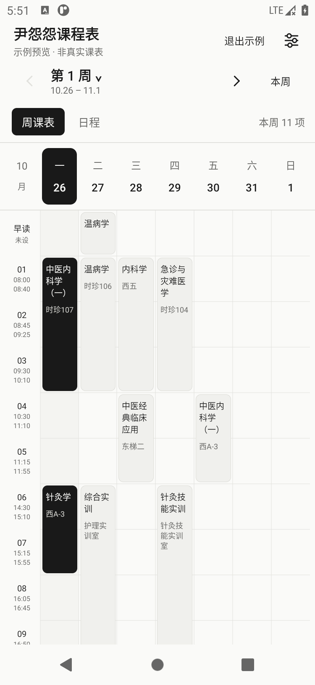
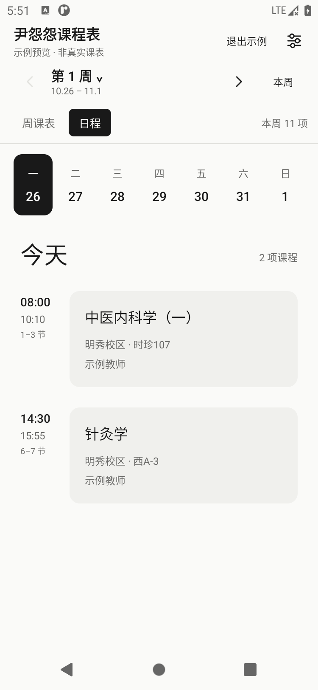
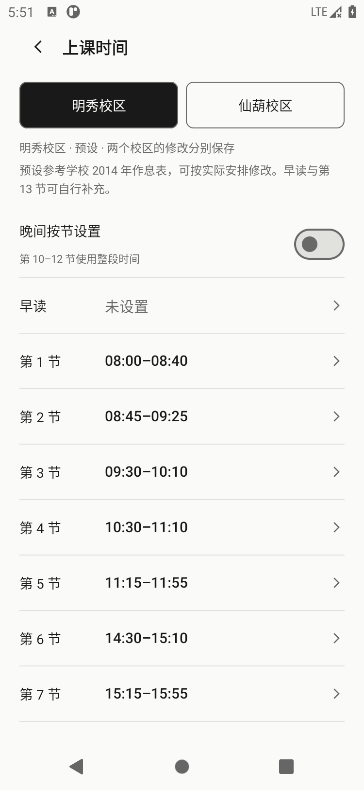
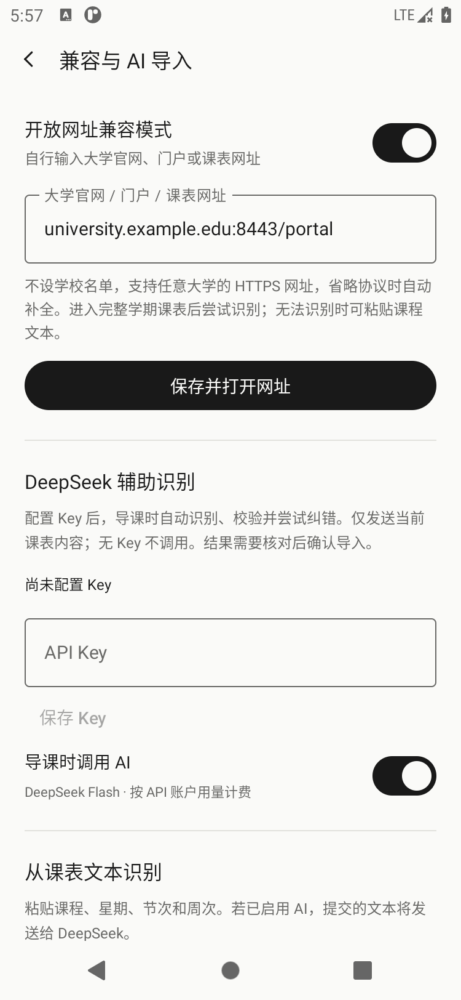

# 尹怨怨课程表

一个黑白简洁的 Android 课程表，把屏幕留给课程和日程。支持广西中医药大学课表导入，也可以输入其他大学的网址尝试兼容识别。导入后可离线查看，不配置 AI 也能使用。

**Android 11 及以上 · 周课表 / 日程 · 左右滑动切周 · 自定义上课时间 · 可选 AI 导入**

[下载 APK](https://github.com/KuiYiyinRua/YinYuanyuanTimetable/releases/download/v1.0.2/YinYuanyuanTimetable-1.0.2.apk) · [所有版本与更新说明](https://github.com/KuiYiyinRua/YinYuanyuanTimetable/releases) · [反馈问题](https://github.com/KuiYiyinRua/YinYuanyuanTimetable/issues)

当前提供 **v1.0.2 测试版**。这是独立开发的工具，并非学校官方应用；其他大学课表为尽力兼容，不保证所有格式均可导入。

## 软件截图

以下为 1.0.2 实际运行截图，课程为示例数据，不含真实个人课表；兼容页面的网址为演示占位地址，使用时请填写自己学校的网址。

<table>
  <tr><th>周课表</th><th>日程</th></tr>
  <tr>
    <td></td>
    <td></td>
  </tr>
  <tr><th>自定义上课时间</th><th>开放网址与 AI 导入</th></tr>
  <tr>
    <td></td>
    <td></td>
  </tr>
</table>

## 功能介绍

| 功能 | 可以做什么 |
| --- | --- |
| 周课表与日程 | 一屏查看一周安排，或按天阅读课程、地点与教师；点击课程查看详情 |
| 快速切周 | 左滑下一周、右滑上一周，也可选择周数或返回本周 |
| 学校课表导入 | 在应用内打开广西中医药大学融合门户，自行登录后进入课表导入 |
| 开放网址兼容 | 输入其他大学的 HTTPS 官网、门户或课表网址，尝试识别常见 HTML 表格 |
| 文本与 AI 导入 | 可粘贴课表文本；配置自己的 DeepSeek Key 后可辅助识别、校验与纠错 |
| 时间与学期设置 | 明秀 / 仙葫作息预设，可自定义每节时间与第一教学周日期 |
| 复杂排课 | 支持单双周、多段周次、连堂、早读、晚间、周末和重叠课程 |
| 离线查看 | 导入的课表保存在本机，之后查看无需联网 |

## 下载与安装

1. 用安卓手机点击上方 **下载 APK**，或进入 [Releases](https://github.com/KuiYiyinRua/YinYuanyuanTimetable/releases)，展开版本下的 **Assets**，选择 `YinYuanyuanTimetable-1.0.2.apk`。
2. 下载完成后打开 APK。若系统要求安装权限，仅为用于打开该文件的浏览器或文件管理器允许安装，然后按系统提示完成安装。
3. 打开“尹怨怨课程表”。可先查看示例，熟悉界面后再导入自己的课表。

**不要下载 `Source code (zip)` / `Source code (tar.gz)` 来安装**，它们是给开发者使用的源码。`.apk.sha256` 是校验文件，也不是安装包。

需要 Android 11 或更新系统，目前没有 iOS 版本。1.0.2 使用开发签名，可覆盖作者此前提供的 1.0.0 / 1.0.1；自行构建版本的签名可能不同。更新时优先直接覆盖安装，卸载会清除应用内的课表和设置。

## 使用教程

### 1. 导入广西中医药大学课表

1. 打开应用，若正在查看示例，先退出示例。
2. 点击“从融合门户导入”，在学校页面自行登录。
3. 在融合门户点击“教务系统”，进入“个人课表查询”。也可在已建立教务会话后点击应用顶部的“个人课表”。选择需要的学年、学期并查询。
4. 页面显示完整课表且内容稳定后，应用自动导入并返回周课表。可取消“自动导入”，改为点击“导入当前页”。每次导入替换当前课表，不叠加重复记录。
5. 在“课表设置”中设置第一教学周的周一，之后自动定位当前周。也可点击“从学校页面识别”：在学校页面存在同学期的明确第一周周一，或当前日期与当前教学周时进行推算。没有可靠信息时保留原设置并提示手动设置。

第一周没有设置时，应用显示教学周和星期，不虚构日期。左右滑动课表或日程可切换周次：左滑下一周，右滑上一周，第一周和最后一周不会循环跳转；上下滚动仍用于查看当天或晚间课程。

### 2. 设置上课时间

“设置 → 上课时间”可选择明秀或仙葫校区，默认使用明秀预设。预设逐项取自用户提供的学校 2014 年作息表，每节可修改、清空，两个校区的修改分别保存。可恢复当前校区预设，清除课表不会删除自定义时间。

周课表左侧、日程和课程详情都会显示时间。原图仅列出第 10–12 节合计 19:00–21:20，未提供三节之间的分界，因此默认按整段显示；可开启“晚间按节设置”自行补全。早读和第 13 节原图没有时间，默认留空。若一门课只占晚间部分节次，会注明时间包含整段，不虚构精确钟点。

操作顺序：打开设置 → 上课时间 → 选择校区 → 点击需要修改的节次 → 设置上课和下课时间 → 保存。之后返回课表即可查看。

### 3. 导入其他大学的课表

1. 打开“设置 → 兼容与 AI 导入”，开启“开放网址兼容模式”。
2. 填写自己学校官网、融合门户或课表的 HTTPS 网址，点击“保存并打开网址”。
3. 在网页中自行登录，导航到需要的学年、学期，显示完整学期课表。
4. 等待自动识别，或点击“导入当前页”。核对课程名称、星期、节次和单双周，再确认导入。
5. 如网页无法识别，返回兼容设置，使用“从课表文本识别”粘贴课程文本。没有 Key 也可以使用本地规则。

在“设置 → 兼容与 AI 导入”开启“开放网址兼容模式”，自行填写任意大学官网、门户或课表的 HTTPS 地址，保存并打开网页。**不设学校名单，不需要逐校适配配置**；省略协议时自动补全 HTTPS，也支持自定义 HTTPS 端口。进入完整学期课表后尝试识别正方相近结构、以星期为列的普通 HTML 课表（含合并单元格）和包含课程名称、星期、节次、周次等表头的列表。仍需用户自行完成学校登录。未知网页、图片、PDF、跨域内嵌页面和特殊教务格式不保证识别成功。

网页未识别时可手动粘贴课表文本。无 Key 使用本地规则，例如每行 `大学英语 | 周一 第1-2节 1-16周`。本地规则不能确定周次等必要字段时会拒绝导入，不默认整学期都有课。文本超过 50,000 字符会要求调整范围，不会静默截取。

### 4. 可选：开启 DeepSeek 辅助识别

在“设置 → 兼容与 AI 导入”输入自己的 DeepSeek API Key，点击“保存 Key”，并开启“导课时调用 AI”，再按上面的方式导入网页或文本。请不要把 Key 发到 GitHub Issue 或公开截图中。

之后导课时会自动调用官方 `deepseek-flash`，按课程原文整理并校验星期、节次和周次；结果不通过校验时最多自动请求纠正一次。API 使用费用由该 Key 对应的账户承担。**没有 Key 或关闭 AI 时，不请求 DeepSeek。** 普通课表查看无需 Key，安装包不附赠 API 服务。

兼容模式和 AI 结果均先显示核对页，确认后才替换当前课表。AI 不可用但本地识别成功时，会明确提示并展示本地结果；无法识别时保留原课表。自动识别为辅助功能，不能保证任意大学格式、缺失资料或 AI 推断都正确，请核对完整性、单双周和节次。默认广西中医药大学格式且未启用 AI 时保留原来的自动导入流程。

<details>
<summary>完整功能清单</summary>

- 使用用户提供的头像作为桌面图标，适配圆形与圆角图标遮罩。
- 紧凑三行顶部：标题与学期、周次与日期、视图切换；优先为课表和日程保留空间。
- 周课表、逐日日程、左右滑动切周、周次选择、返回本周、完整课程详情。
- 明秀/仙葫作息预设、自定义上下课时间、两校区独立保存。
- 多段周次、每段独立单双周、连堂课、早读、晚间课与周末课。
- 重叠课程全部保留，可打开同一时间块查看所有课程。
- 自动导入、手动触发导入、离线保存、重新导入、清除课表和退出学校登录。
- 广西中医药大学专用解析、其他学校的常见表格兼容模式、文本导入与可选 DeepSeek 辅助识别。
- 示例预览独立于真实课表，示例不会写入本地课程数据。

</details>

## 常见问题

**导入后周数或日期不对？** 先核对所选学期，再在设置中修改“第一教学周的周一”。学校页面没有可靠日期信息时需要手动设置；左右滑动只切换正在查看的周数。

**登录成功了，为什么没有导入？** 门户首页不是课表页面。请继续进入教务系统的个人课表查询，选择学年、学期并查询，等待完整课表显示，再尝试“导入当前页”。验证码需自行完成。

**其他大学的网址打不开或识别失败？** 当前只支持 HTTPS。先检查网址是否正确、学校网站是否需要校园网络。图片、PDF、跨域内嵌页面或特殊课表格式可能无法识别，可尝试粘贴包含星期、节次、周次的文本。AI 也不能保证识别所有格式。

**重新导入会重复添加课程吗？** 不会。确认导入会替换当前课表；无法识别或取消核对时保留原课表。

**必须联网、配置 Key 吗？** 查看已导入课表不需要联网；登录学校和导入网页需要网络。AI 完全可选，启用后会发送课程内容到 DeepSeek，详见下方“数据处理”。

**如何反馈问题？** 在 [Issues](https://github.com/KuiYiyinRua/YinYuanyuanTimetable/issues) 提供应用版本、Android 版本、学校及问题发生步骤。截图或课表样本请先隐去姓名、学号、账号信息和 Key。

## 作者与支持

作者：[尹怨怨 · B 站](https://space.bilibili.com/3546821542545653)。如果这个小工具对你有帮助，欢迎给仓库点 Star，或到 Steam 关注作者的游戏[《与中草药娘的日常》](https://store.steampowered.com/app/4893790/%E4%B8%8E%E4%B8%AD%E8%8D%89%E8%8D%AF%E5%A8%98%E7%9A%84%E6%97%A5%E5%B8%B8/)。应用设置底部也有入口，仅在点击时打开外部页面。

## 格式适配依据

适配以下学校页面的课表结构：

- [个人课表](https://jwxt.gxtcmu.edu.cn/jwglxt/kbcx/xskbcx_cxXskbcxIndex.html?gnmkdm=N253508&layout=default)
- [融合门户](https://ehall.gxtcmu.edu.cn/default/index.html#/)

从 `#kbgrid_table_0 .timetable_con` 读取课程。最近的 `td` 的编号仅用于确定星期；每条课程的起止节次取“节/周”字段，不能使用单元格编号推断。学校的 `14` 表示早读，排在第 1 节之前。测试夹具包含 59 条匿名排课，覆盖相应时间表达式。

原始 Edge 页面只用于确认格式；APK 不包含用户的真实课表、学生身份、Cookie 或密码。个人课表需要在手机上重新登录导入。

## 数据处理

只申请网络权限，不申请文件、相册、通知或无障碍权限。课程通过应用私有文件原子保存，未完成或无效导入不会覆盖现有课表。没有统计 SDK 或广告 SDK，设置底部仅有用户要求的静态作者推广图。

默认导入仅打开广西中医药大学 HTTPS 域名，课表提取限定在教务系统域名。用户主动开启兼容模式后允许其他 HTTPS 学校网页。保留网页正常登录状态；用户可在设置退出登录。不开启原生 JavaScript 桥，不忽略证书错误，禁用文件访问和混合 HTTP 内容。禁止系统云备份和设备迁移备份。学校自身对登录数据的处理由学校系统负责。

配置并开启 AI 后，应用仅将提取到的课程内容（课程名、周次、节次、地点、教师等）或用户提交的文本发送给 DeepSeek 官方接口，不附带网页登录 Cookie、密码输入框、学号或学生姓名栏。请勿在手动粘贴的文本中包含不需要识别的个人信息。Key 通过 Android Keystore 的 AES-GCM 加密保存在本机，可以随时清除；不显示已保存的明文，不随 APK 分发。剪贴板仅在用户点击粘贴时读取。

## 开发和验证

- JDK 17 或 21、Android SDK 35。
- Gradle 8.11.1、AGP 8.9.2、Kotlin 2.1.20、Compose BOM 2025.04.01。
- 在本地 `local.properties` 设置 `sdk.dir`，该文件不应提交。

Windows 构建：

```powershell
.\build.ps1 -JdkPath '你的 JDK 目录'
```

或运行：

```text
gradlew.bat :app:assembleDebug :app:testDebugUnitTest :app:lintDebug :app:assembleDebugAndroidTest
```

`build.ps1` 完成构建、单元测试与 lint 后将 APK 和 SHA-256 输出到 `dist`。测试 APK 仅包含匿名夹具，不随主安装包分发。

设备测试覆盖真实 WebView 的 HTTPS 导航、生产提取脚本、自动保存、无效导入保护，以及示例、日程、滑动切周、时间编辑持久化、作者链接目标、兼容课表预览确认和 Key 加密存储。设备测试以本地匿名 HTML 响应替代学校网络，不能代表真人账号的完整 SSO 登录已经验证。手机登录和可能出现的验证码由使用者完成。

可选的 DeepSeek 实网测试脚本 `tools/test-deepseek-clipboard.py` 从标准输入读取 Key，仅发送三个匿名课程样本，用于验证混合单双周及早读；运行前创建 `verification` 目录。该测试会产生 API 费用，常规构建和单测不会调用 API。不要将 Key 写入命令历史、源码或日志。主安装包不含测试 Key 或测试课表。

学校修改页面结构、认证策略或访问限制时，需要重新验证适配。

## 开源许可

代码采用 [MIT License](LICENSE)。头像和游戏宣传图不在 MIT 许可范围内，详见 [图片素材说明](ASSETS.md)。本项目为独立工具，并非学校官方应用。
